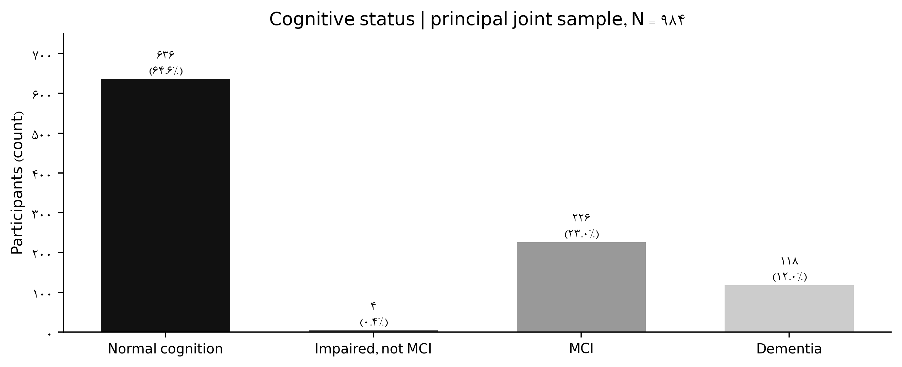
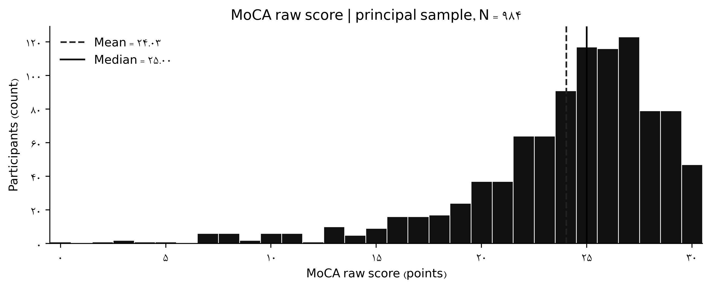
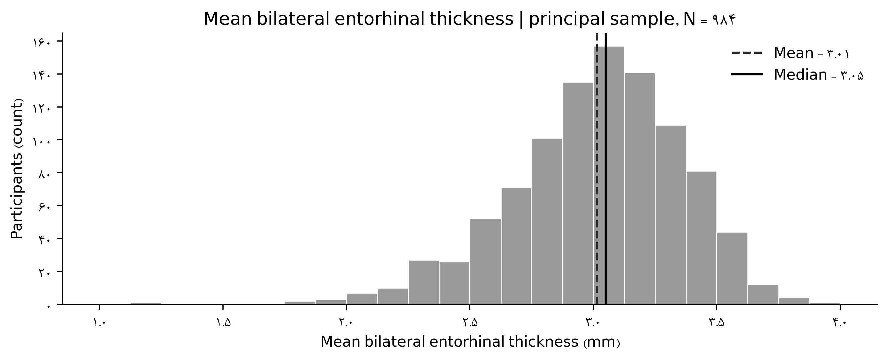
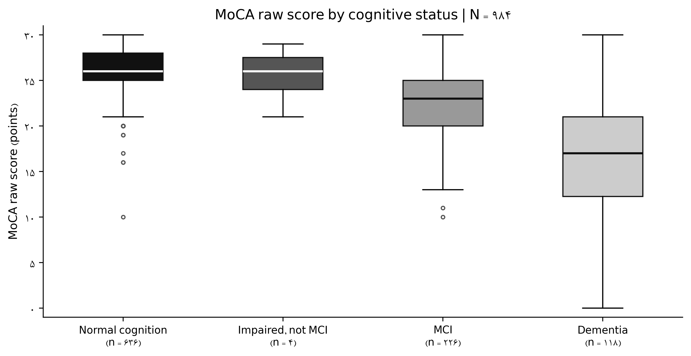
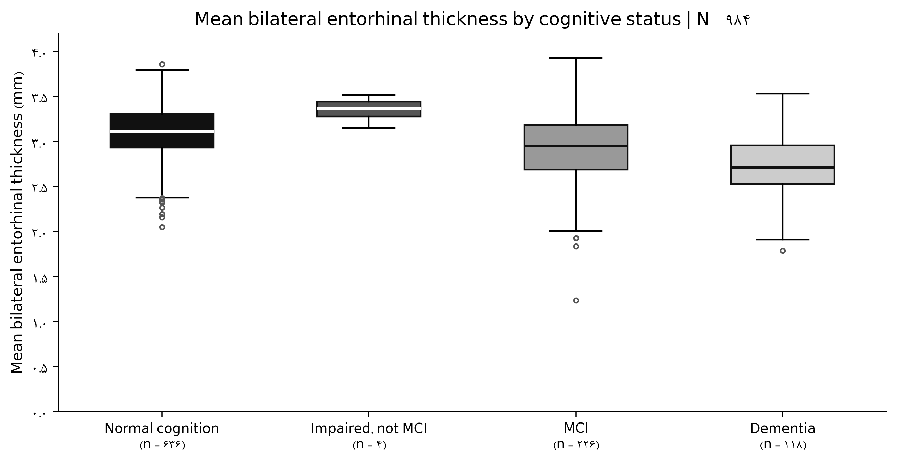

# توصیف نمرهٔ MoCA و ضخامت قشر انتورینال برحسب وضعیت شناختی در زیرمجموعهٔ NACC

**پروژهٔ درس آمار | پاییز ۱۴۰۵ | فاز اول**  
مسیر ج: NACC UDS + MRI  
**نام و نام خانوادگی: آرام بقائی راد**  
**شمارهٔ دانشجویی: ۴۰۳۱۰۰۰۷۶**

## چکیده

این مطالعهٔ مشاهده‌ای، مقطعی در فایل‌های آمادهٔ درس، توزیع نمرهٔ شناختی MoCA و ضخامت متوسط قشر انتورینال دو نیمکره را برحسب وضعیت شناختی ثبت‌شده توصیف می‌کند. هر فایل UDS و MRI دارای 1237 رکورد با شناسهٔ یکتا است و همهٔ افراد بین دو فایل مشترک‌اند. پس از کنارگذاشتن 4 کد ویژه، 5 مقدار خارج از دامنه و 244 مقدار اعشاری حل‌نشدهٔ MoCA، نمونهٔ اصلی شامل 984 فرد شد. مقادیر اعشاری داخل دامنه در یک توصیف تکمیلی مشروط با 1228 فرد نیز حفظ شدند. در نمونهٔ اصلی، میانهٔ MoCA در گروه‌های طبیعی، اختلال غیر MCI، MCI و دمانس به‌ترتیب 26.00, 26.00, 23.00, 17.00 بود. میانهٔ ضخامت دوطرفه به‌ترتیب 3.108, 3.369, 2.949, 2.713 میلی‌متر بود. گروه غیر MCI تنها 4 عضو در نمونهٔ اصلی دارد؛ بنابراین الگوی آن باید با احتیاط خوانده شود. این یافته‌ها صرفاً توصیف همین زیرمجموعه‌اند؛ روش جایگذاری قبلی و هم‌زمانی مراجعه و اسکن قابل بازیابی نیست.

## ۱. سؤال و اهداف

«نمرهٔ MoCA و میانگین ضخامت قشر انتورینال در گروه‌های مختلف وضعیت شناختیِ شرکت‌کنندگان، چه توزیع و تفاوت‌های توصیفی دارند؟»

هدف، توصیف توزیع‌ها، مرکز، پراکندگی و تفاوت‌های مشاهده‌شدهٔ دو متغیر کمی میان چهار گروه ثبت‌شده است. سؤال بدون تغییر حفظ شد، زیرا هر دو سنجه و گروه‌بندی در داده موجودند. محدودیت نمره‌های اعشاری به‌جای تغییر سؤال، با تعریف دو مجموعهٔ تحلیلی روشن مدیریت شد. هیچ آستانهٔ MoCA برای تعیین تشخیص به کار نرفته است. همهٔ مقایسه‌ها اکتشافی و توصیفی‌اند؛ آزمون فرض، فاصلهٔ اطمینان، رگرسیون و استنباط اجرا نشده است.

## ۲. منشأ، طراحی و دامنهٔ تفسیر

NACC مرکز هماهنگ‌کنندهٔ داده‌های مراکز پژوهش بیماری آلزایمر در آمریکا است. UDS از سال ۲۰۰۵ با ارزیابی بالینی استاندارد و پیگیری برنامه‌ریزی‌شدهٔ سالانه گردآوری می‌شود. جذب در مراکز با ارجاع بالینی، داوطلبی و روش‌های محلی انجام می‌شود؛ بنابراین نمونهٔ احتمالی جمعیت نیست [S5]. این تاریخ آغاز پایگاه است و دورهٔ جمع‌آوری زیرمجموعهٔ حاضر را تعیین نمی‌کند.

اطلاعات بالینی و شناختی از UDS و اندازه‌گیری‌های ساختاری از MRI هستند. فایل‌های حاضر انتخاب و آماده‌سازی تیم درس‌اند، نه کل NACC. تاریخ مراجعه و اسکن، مراکز مبدأ، تاریخ استخراج، معیار دقیق ورود به زیرمجموعه، شیوهٔ انتخاب مراجعه، نسخهٔ فرم هر فرد و الگوریتم جایگذاری همراه فایل‌ها نیست. دورهٔ واقعی گردآوری همین افراد نامعلوم است. زمان دسترسی این تحلیل به فایل‌ها ۱۰ آبان ۱۴۰۵ است؛ این زمان نباید با دریافت اولیهٔ داده از NACC یکی گرفته شود.

این مطالعه آزمایش تصادفی نیست و مداخله‌ای تخصیص داده نشده است. جمعیت قابل تفسیر، افراد دارای رکورد در زیرمجموعهٔ آمادهٔ درس و، در مقایسه‌های اصلی، افراد واجد قواعد اعتبار سنجه‌هاست. نتایج را نمی‌توان به جمعیت عمومی، همهٔ سالمندان، همهٔ افراد مبتلا به آلزایمر یا کل NACC تعمیم داد. دمانس یک گروه سندرمی است و در این تحلیل معادل تشخیص علت‌شناختی آلزایمر نیست.

دسترسی پژوهشی NACC تابع درخواست و توافق استفاده از داده است [S6]. این تحلیل مجوز دسترسی مستقل جدیدی ایجاد نمی‌کند. فایل‌های خام و شناسه‌های فردی در بستهٔ تحویل و مخزن عمومی قرار نمی‌گیرند. مستندات عمومی فقط برای تعریف متغیرها استفاده شدند؛ دادهٔ شرکت‌کنندهٔ بیرونی وارد نشده است.

### جدول ۱. نمای فایل‌ها

| نام دقیق فایل | ردیف | ستون | نقش |
| --- | --- | --- | --- |
| udslong_imputed(7).csv | 1237 | 180 | رکورد آمادهٔ بالینی و شناختی |
| mriscanclean(7).csv | 1237 | 126 | اندازه‌گیری‌های ناحیه‌ای MRI |
| combined_adjacency_matrix(7).csv | 62 | 63 | ماتریس ناحیه × ناحیه؛ بدون فرد |

نام دقیق فایل و SHA-256 کامل در `tables/01_file_inventory.csv` ثبت شده است. پسوند (7) صرفاً مربوط به بارگذاری است. ورودی‌ها تغییر نکرده‌اند.

## ۳. ساختار فرد، رکورد و مراجعه

واحد تحلیل یک شرکت‌کننده با یک رکورد آماده در هر وجه است. یک ردیف UDS شامل متغیرهای فردی و بالینی است و یک ردیف MRI شامل سنجه‌های چند ناحیه از همان شناسه است. هر سنجهٔ ناحیه‌ای ستون است؛ نواحی به‌عنوان افراد مستقل شمارش نشده‌اند.

| وجه | ردیف | فرد یکتا | رکورد برای هر فرد | شناسهٔ تکراری | تاریخ/شمارهٔ مراجعه یا اسکن |
| --- | --- | --- | --- | --- | --- |
| UDS | 1237 | 1237 | ۱ | 0 | موجود نیست |
| MRI | 1237 | 1237 | ۱ | 0 | موجود نیست |

توزیع تعداد رکورد در فایل‌ها تنها در مقدار ۱ متمرکز است. این نتیجه تعداد مراجعات تاریخی افراد را نشان نمی‌دهد. واژهٔ long در نام UDS دلیل وجود دادهٔ طولی قابل تحلیل در این فایل نیست. هیچ بازسازیِ مراجعهٔ اولیه، آخرین مراجعه، نزدیک‌ترین اسکن یا فاصلهٔ UDS–MRI انجام نشده است.

قاعدهٔ انتخاب برای ادامهٔ کار، استفاده از تنها رکورد آمادهٔ هر شناسه در این نسخه است. اگر نسخه‌ای با رکوردهای متعدد دریافت شود، کد متوقف می‌شود تا تاریخ‌ها و قاعدهٔ انتخابِ مورد تأیید تیم درس مشخص شوند. ردیف اول یا میانگین دلخواهِ مراجعات انتخاب نمی‌شود. استقلال در شمارش فردی کنترل شده، اما وابستگی بالقوهٔ مرکز یا خانواده بدون فراداده قابل بررسی نیست.

### نقشهٔ متغیرها

در UDS، حوزه‌های جمعیت‌شناختی، سابقهٔ خانوادگی، سابقهٔ پزشکی و عوامل خطر، دارو، معاینهٔ جسمی، علائم عصب‌روان‌پزشکی، خلق، عملکرد روزمره، شناخت، ژنتیک و درجه‌بندی بالینی قابل تفکیک‌اند. این نقشه، دسته‌بندی محتوایی است؛ معنای همهٔ کدهای همهٔ ستون‌ها ادعای تأیید ندارد. فرهنگ اختصاصی آماده‌سازی تحویل نشده است.

| حوزهٔ UDS | تعداد | حوزهٔ UDS | تعداد |
| --- | --- | --- | --- |
| شناسه | 1 | جمعیت‌شناختی | 12 |
| سابقهٔ خانوادگی | 11 | سابقهٔ پزشکی و عوامل خطر | 50 |
| دارو | 20 | معاینه و اندازه‌گیری جسمی | 14 |
| علائم عصب‌روان‌پزشکی | 25 | خلق و افسردگی | 17 |
| عملکرد روزمره | 10 | شناختی | 10 |
| ژنتیک | 1 | وضعیت شناختی | 1 |
| درجه‌بندی بالینی شناخت و عملکرد | 8 |  |  |

فایل MRI شامل 31 ناحیه در هر نیمکره با دو نوع سنجه (62 ضخامت و 62 حجم)، به‌علاوهٔ NACCID و NACCUDSD است. LH و RH به‌ترتیب نیمکرهٔ چپ و راست را مشخص می‌کنند. AVGTH ضخامت متوسط با واحد mm و GVOL حجم مادهٔ خاکستری با واحد mm³ است [S4]. موجودی کامل همهٔ ستون‌ها، ناحیه و نیمکره، نوع داده، دامنه و گمشدگی در `tables/02_all_variable_inventory.csv` آمده است.

## ۴. متغیرهای اصلی و تعریف عملیاتی

کد وضعیت شناختی در تحلیل یک متغیر طبقه‌ای است؛ فاصلهٔ عددی کدهای ۱ تا ۴ مقدار قابل میانگین‌گیری نیست. ترتیب گروه‌ها فقط برای نمایش ثابت است و به معنی فواصل مساوی شدت بیماری نیست. MoCA یک نمرهٔ مرکب و گسسته است؛ میانگین آن خلاصه‌ای آموزشی از امتیاز است و تفسیر نسبت دو نمره مناسب نیست.
**`NACCID`**: شناسهٔ ناشناس فرد؛ اسمی؛ بدون واحد؛ نقش: کلید اتصال. قاعده: یکتا، غیرتهی؛ بدون تبدیل عددی. منبع: S2 / S5.

**`NACCUDSD`**: وضعیت شناختی ثبت‌شده؛ طبقه‌ای؛ اسمی برای تحلیل؛ نقش: گروه‌بندی. قاعده: ۱ طبیعی؛ ۲ اختلال غیر MCI؛ ۳ MCI؛ ۴ دمانس. منبع: S2، PDF ص۲۶۹.

**`MOCATOTS`**: نمرهٔ خام MoCA؛ تصحیح‌نشده برای تحصیلات؛ کمی گسسته؛ امتیاز مرکب، فاصله‌ای تقریبی؛ نقش: متغیر توصیفی. قاعده: صحیح ۰–۳۰؛ ۸۸ انجام‌نشده؛ منفی۴ ناموجود ساختاری. منبع: S2، ص۲۳۸؛ S3، C2.

**`NACCAGE`**: سن در مراجعهٔ ثبت‌شده؛ کمی؛ سال، نسبتی؛ نقش: زمینهٔ جمعیت‌شناختی. قاعده: ۱۸–۱۲۰؛ سن اولیه فرض نمی‌شود. منبع: S2، ص۵۵.

**`SEX`**: جنس ثبت‌شده؛ اسمی دودویی؛ بدون واحد؛ نقش: توصیف نمونه. قاعده: ۱ مرد؛ ۲ زن؛ سایر ناموجود. منبع: S3، PDF ص۱۵.

**`EDUC`**: سال‌های تحصیل؛ کمی گسسته؛ سال، نسبتی؛ نقش: توصیف نمونه. قاعده: ۰–۳۶؛ ۹۹ نامعلوم؛ بدون گردکردن. منبع: S2، ص۵۳؛ S3، A1.

**`LH_ENTORHINAL_AVGTH`**: ضخامت متوسط انتورینال چپ؛ کمی پیوسته؛ mm، نسبتی؛ نقش: جزء شاخص MRI. قاعده: متناهی و مثبت؛ افراطی‌ها فقط پرچم بازبینی. منبع: S4، ص۱۵.

**`RH_ENTORHINAL_AVGTH`**: ضخامت متوسط انتورینال راست؛ کمی پیوسته؛ mm، نسبتی؛ نقش: جزء شاخص MRI. قاعده: همان قاعدهٔ نیمکرهٔ چپ. منبع: S4، ص۱۵.

**`ENTORHINAL_BILATERAL_MEAN`**: میانگین سادهٔ دو نیمکره؛ مشتق پیوسته؛ mm، نسبتی؛ نقش: متغیر توصیفی MRI. قاعده: فقط در حضور دو مقدار معتبر؛ بدون میانگین یک‌طرفه. منبع: تعریف عملیاتی این پروژه.

### شاخص مشتق MRI

میانگین ضخامت دوطرفه = (ضخامت انتورینال چپ + ضخامت انتورینال راست) ÷ ۲.

وزن دو نیمکره برابر است و این مقدار میانگین وزنی برحسب سطح یا حجم نیست. اگر یکی از دو مقدار نامعتبر یا ناموجود باشد، شاخص دوطرفه ناموجود می‌شود. دو نیمکره برای ممیزی و جدول تکمیلی حفظ شده‌اند.

تعریف و واحد ستون‌های MRI با نام‌های دقیق مستندات رسمی S4 تطبیق دارد. بااین‌حال از این تطبیق نمی‌توان نتیجه گرفت که همین زیرمجموعه حتماً از پروژهٔ SCAN یا CLARiTI، با همان نسخهٔ FreeSurfer یا همان مراحل کنترل کیفیت استخراج شده است. پروتکل واقعی فایل آماده و هر تبدیل پیشین نیازمند تأیید تیم درس است.

## ۵. ممیزی و قواعد پاک‌سازی

در ورودی‌های UDS و MRI هیچ سلول تهی صریح دیده نشد. این به معنی نبود گمشدگی اصلی نیست. نام فایل UDS احتمال جایگذاری پیشین را مطرح می‌کند، اما روش، مدل، متغیرهای استفاده‌شده و پرچمِ مقادیر جایگذاری‌شده موجود نیست. حتی مقدار صحیحِ درون دامنه نیز الزاماً مشاهدهٔ اصیل نیست.

کد ۸۸ در MOCATOTS یعنی همه یا بخشی از آزمون اجرا نشده است، نه امتیاز ۸۸؛ منفی ۴ نیز در فرهنگ عمومی کد ناموجود ساختاری است [S2/S3]. در دادهٔ حاضر 4 کد ویژه و 5 مقدار دیگر بالاتر از ۳۰ وجود دارد. این مقادیر به ۳۰ برش داده نشدند. 244 نمرهٔ اعشاری بین ۰ و ۳۰ نیز از تحلیل اصلی کنار گذاشته شد؛ این تصمیم یک محدودیت مبتنی بر اعتبار کدگذاری است و به معنی اثبات اشتباه‌بودن هر مقدار اعشاری نیست. خلاصهٔ آن‌ها بدون گردکردن در توصیف تکمیلی نگهداری شد.

در EDUC، کد ۹۹ برای 2 نفر به ناموجود تبدیل شد؛ چون تحصیلات جزء شروط نمونهٔ اصلی نیست، این کار فرد را از مقایسهٔ اصلی حذف نمی‌کند. صفر سال تحصیل و صفر MoCA، اگر با قواعد دیگر سازگار باشند، معتبرند. برای دسته‌های جنس و شناخت هیچ گردکردن اعمال نشد.

### جدول ۴. گمشدگی صریح و عدم دسترسی تحلیلی

| متغیر | کل | تهی صریح | ناموجود/حل‌نشده پس از قاعده | درصد |
| --- | --- | --- | --- | --- |
| NACCUDSD | 1237 | 0 | 0 | 0.00 |
| MOCATOTS | 1237 | 0 | 253 | 20.45 |
| NACCAGE | 1237 | 0 | 0 | 0.00 |
| SEX | 1237 | 0 | 0 | 0.00 |
| EDUC | 1237 | 0 | 2 | 0.16 |
| LH_ENTORHINAL_AVGTH | 1237 | 0 | 0 | 0.00 |
| RH_ENTORHINAL_AVGTH | 1237 | 0 | 0 | 0.00 |
| ENTORHINAL_BILATERAL_MEAN | 1237 | 0 | 0 | 0.00 |

درصدها از کل رکورد همان وجه محاسبه شده‌اند. «ناموجود پس از قاعده» شامل مقادیر حل‌نشده است و برآورد درصد گمشدگی در پایگاه اصلی نیست. دامنه، اعشار و تعداد مقادیر یکتای تمام ستون‌ها در موجودی ثبت شده‌اند؛ پاک‌سازی تفصیلی کدهای ویژه فقط برای متغیرهای منتخب انجام شده است.

### جدول ۵. دفتر تصمیم‌های پاک‌سازی

| متغیر/موضوع | مسئله | تعداد مقدار و فرد | تصمیم |
| --- | --- | --- | --- |
| MOCATOTS | کد ویژه ۸۸ یا منفی ۴ | 4 | تبدیل به ناموجود تحلیلی |
| MOCATOTS | خارج از دامنه و غیرکد ویژه | 5 | عدم برش به ۳۰؛ ناموجود |
| MOCATOTS | اعشاری داخل دامنه | 244 | بدون گردکردن؛ حذف از اصلی، حفظ در تکمیلی مشروط |
| EDUC | کد ۹۹ | 2 | ناموجود؛ بدون حذف فرد از سؤال اصلی |
| LH_ENTORHINAL_AVGTH | اندازهٔ کمتر از ۱ mm برای بازبینی | 1 | حفظ؛ بدون تصویر و QC داوری قطعی ممکن نیست |
| RH_ENTORHINAL_AVGTH | اندازهٔ کمتر از ۱ mm برای بازبینی | 3 | حفظ؛ بدون تصویر و QC داوری قطعی ممکن نیست |

هر ردیف این جدول شمارش مربوط به همان متغیر است؛ نباید تعداد افراد در ردیف‌های متفاوت را جمع کرد. در این فایل‌ها هر متغیر یک مقدار برای هر فرد دارد، بنابراین شمار مقدار و فردِ هر ردیف یکسان است.

مقدار MRI مثبت و متناهی از نظر عملیاتی قابل استفاده محسوب شد؛ آستانهٔ قطعی بالینی برای حذف وضع نشده است. ضخامت کمتر از ۱ میلی‌متر و نقاط بیرون حصار ۱٫۵ برابر دامنهٔ بین‌چارکی برای بازبینی علامت‌گذاری شدند. بدون تصویر خام و کنترل کیفیت، افراطی‌بودن دلیل حذف نیست. تمام این نقاط در آمار و شکل‌ها باقی ماندند.

### جدول ۶. پرچم‌های IQR در نمونهٔ اصلی

| سنجه | حصار پایین | حصار بالا | تعداد پرچم | اقدام |
| --- | --- | --- | --- | --- |
| MoCA (امتیاز) | 14.500 | 34.500 | 48 | حفظ برای بازبینی |
| ضخامت دوطرفه (mm) | 2.122 | 3.935 | 13 | حفظ برای بازبینی |
| ضخامت چپ (mm) | 2.039 | 3.946 | 19 | حفظ برای بازبینی |
| ضخامت راست (mm) | 2.133 | 4.036 | 18 | حفظ برای بازبینی |

دامنهٔ بین‌چارکی (IQR) اختلاف چارک سوم و اول است. پرچم‌ها تابع توزیع و جمعیت انتخاب‌شده‌اند. وجود چند گروه با میانگین‌های متفاوت می‌تواند پرچم کلی ایجاد کند. در بررسی منطقی، نمرهٔ خام بالاتر از سقف، اعتبار کدها، دوطرفه‌بودن شاخص، یکتایی شناسه و توافق گروه‌بندی دو وجه کنترل شد. تشخیص بالینی از تطبیق MoCA با آستانه استنتاج نشده است.

## ۶. اتصال و جمعیت‌های تحلیلی

اتصال بر NACCID با کنترل صریح یک‌به‌یک انجام شد. قبل از اتصال، شناسهٔ خالی، تکرار شناسه و تکرار کامل ردیف بررسی شدند؛ همه صفر بودند. دو ستون NACCUDSD با پسوندهای uds و mri جدا حفظ شدند. تعداد اختلاف 0 بود. منبع گروه‌بندی UDS است، چون متغیر وضعیت در ماهیت خود بالینی است؛ توافق دو نسخه نیاز به آشتی‌دادن را برطرف می‌کند، ولی هم‌زمانی را اثبات نمی‌کند.

هیچ کلید مراجعه یا اسکن دیگری موجود نیست. یک‌به‌یک بودن، اتصال فردی را معتبر می‌کند؛ تأیید اتصال زمانی و انطباق با قاعدهٔ اختصاصی مدرس همچنان قابل ارزیابی نیست.

### جدول ۷. جریان پیوند و نمونه

| مرحله | تعداد |
| --- | --- |
| UDS اولیه | 1237 |
| MRI اولیه | 1237 |
| افراد مشترک پس از انتخاب رکورد موجود | 1237 |
| فقط UDS | 0 |
| فقط MRI | 0 |
| اختلاف وضعیت شناختی دو فایل | 0 |
| حذف مرحله‌ای: وضعیت نامعتبر | 0 |
| حذف مرحله‌ای: MoCA نامعتبر یا حل‌نشده | 253 |
| حذف مرحله‌ای: ضخامت دوطرفه نامعتبر | 0 |
| نمونهٔ اصلی | 984 |
| نمونهٔ تکمیلی مشروط با MoCA اعشاری داخل دامنه | 1228 |

هر 1237 فرد UDS در MRI موجود است؛ مقایسهٔ دارای MRI با فاقد MRI در این فایل‌ها قابل محاسبه نیست. این موضوع نشان نمی‌دهد سوگیری انتخاب MRI وجود ندارد؛ افرادِ کنارگذاشته‌شده پیش از تهیهٔ زیرمجموعه قابل مشاهده نیستند.

جمعیت پیوندی برای خلاصه‌های «دسترسی متغیر به متغیر» استفاده می‌شود. نمونهٔ اصلی مشترک مستلزم گروه معتبر، MoCA صحیح و معتبر و دو ضخامت معتبر است. هر پنج شکل اصلی دقیقاً از همین 984 فرد استفاده می‌کنند. جداول تکمیلیِ MRI در کل پیوندی اطلاعات افراد دارای MoCA حل‌نشده را نیز حفظ می‌کنند. نمونهٔ تکمیلی مشروط، اعشار داخل دامنه را می‌پذیرد و فقط برای توصیف دادهٔ آماده است؛ نتایج آن تأیید نمرهٔ خام اصیل نیست.

### جدول ۸. اثر اعتبار MoCA بر دسترسی گروه‌ها

| گروه | پیوندی | اصلی | حفظ‌شده (%) | اعشاری داخل دامنه | ویژه | خارج از دامنه |
| --- | --- | --- | --- | --- | --- | --- |
| شناخت طبیعی | 847 | 636 | 75.09 | 206 | 1 | 4 |
| اختلال شناختی، غیر MCI | 7 | 4 | 57.14 | 3 | 0 | 0 |
| اختلال شناختی خفیف (MCI) | 252 | 226 | 89.68 | 25 | 0 | 1 |
| دمانس | 131 | 118 | 90.08 | 10 | 3 | 0 |

## ۷. فراوانی‌ها و توزیع تجربی

### جدول ۹. وضعیت شناختی و جنس در کل داده و نمونهٔ اصلی

| جمعیت | متغیر | دسته | تعداد | مخرج | درصد |
| --- | --- | --- | --- | --- | --- |
| کل آماده | شناخت | شناخت طبیعی | 847 | 1237 | 68.47 |
| کل آماده | شناخت | اختلال شناختی، غیر MCI | 7 | 1237 | 0.57 |
| کل آماده | شناخت | اختلال شناختی خفیف (MCI) | 252 | 1237 | 20.37 |
| کل آماده | شناخت | دمانس | 131 | 1237 | 10.59 |
| کل آماده | جنس | مرد (کد ۱) | 497 | 1237 | 40.18 |
| کل آماده | جنس | زن (کد ۲) | 740 | 1237 | 59.82 |
| اصلی | شناخت | شناخت طبیعی | 636 | 984 | 64.63 |
| اصلی | شناخت | اختلال شناختی، غیر MCI | 4 | 984 | 0.41 |
| اصلی | شناخت | اختلال شناختی خفیف (MCI) | 226 | 984 | 22.97 |
| اصلی | شناخت | دمانس | 118 | 984 | 11.99 |
| اصلی | جنس | مرد (کد ۱) | 391 | 984 | 39.74 |
| اصلی | جنس | زن (کد ۲) | 593 | 984 | 60.26 |

در هر دو جمعیت، گروه شناخت طبیعی بیشترین تعداد را دارد. تعداد کوچک گروه اختلال غیر MCI (7 در کل و 4 در اصلی) سبب می‌شود چند مشاهده اثر زیادی بر خلاصه‌های آن بگذارند. جنس ثبت‌شده به معنی متغیر هویت جنسیتی نیست. جدول بالا درصد از کل همان جمعیت است؛ مقدار ناموجود، در صورت وجود، دستهٔ جداگانه دارد.

*شکل ۱. فراوانی گروه‌های وضعیت شناختی در نمونهٔ اصلی مشترک؛ تعداد و درصد هر گروه از کل 984 نفر بالای میله آمده است. ترتیب و رنگ گروه‌ها در همهٔ شکل‌ها ثابت است.*

## ۸. مرکز، پراکندگی و شکل توزیع

انحراف معیار نمونه‌ای با مخرج n−1 و چارک‌ها با درون‌یابی خطی pandas محاسبه شدند. جدول‌ها بر مقادیر معتبر هر متغیر تکیه دارند؛ n و تعداد ناموجود جدا گزارش می‌شوند. میانگین و SD به دنباله‌ها حساس‌اند؛ میانه و IQR برای توزیع نامتقارن مکمل بهتری هستند. حداقل و حداکثر دامنهٔ دیده‌شده‌اند و حدود طبیعی جمعیت نیستند.

### جدول ۱۰. خلاصهٔ کلی در نمونهٔ اصلی

| متغیر | n | ناموجود | میانگین | میانه | SD |
| --- | --- | --- | --- | --- | --- |
| MoCA (امتیاز) | 984 | 0 | 24.028 | 25.000 | 4.739 |
| ضخامت دوطرفه (mm) | 984 | 0 | 3.014 | 3.050 | 0.345 |
| ضخامت چپ (mm) | 984 | 0 | 2.968 | 3.013 | 0.378 |
| ضخامت راست (mm) | 984 | 0 | 3.061 | 3.095 | 0.388 |
| سن (سال) | 984 | 0 | 68.782 | 69.000 | 7.974 |
| تحصیلات (سال) | 982 | 2 | 16.248 | 16.000 | 2.655 |

| متغیر | چارک اول | چارک سوم | IQR | کمینه | بیشینه |
| --- | --- | --- | --- | --- | --- |
| MoCA (امتیاز) | 22.000 | 27.000 | 5.000 | 0.000 | 30.000 |
| ضخامت دوطرفه (mm) | 2.802 | 3.255 | 0.453 | 1.236 | 3.925 |
| ضخامت چپ (mm) | 2.754 | 3.231 | 0.477 | 1.451 | 3.979 |
| ضخامت راست (mm) | 2.847 | 3.323 | 0.476 | 0.729 | 3.967 |
| سن (سال) | 64.000 | 74.000 | 10.000 | 41.000 | 91.000 |
| تحصیلات (سال) | 14.000 | 18.000 | 4.000 | 0.000 | 25.000 |

میانگین MoCA برابر 24.03 و میانه 25.00 است؛ دنبالهٔ پایینِ نمره‌ها، میانگین را پایین‌تر می‌برد. در ضخامت دوطرفه نیز میانگین 3.014 در برابر میانهٔ 3.050 mm قرار دارد. توزیع ضخامت دارای دنبالهٔ مقادیر کوچک‌تر است؛ نزدیک‌بودن این دو شاخص به معنی اثبات تقارن یا نرمال‌بودن نیست.

خلاصهٔ ناحیه‌های چپ و راست به ممیزی کمک می‌کند؛ مقایسهٔ نیمکره‌ها سؤال اصلی پروژه نیست و برای آن آزمون انجام نشده است. جدول کاملِ دسترسی متغیر به متغیر در کل پیوندی نیز در `07_overall.csv` با برچسب جمعیت جدا وجود دارد.

### توزیع MoCA

*شکل ۲. هیستوگرام MoCA در نمونهٔ اصلی (N=984)، با پهنای طبقهٔ یک امتیاز؛ خط‌چین میانگین و خط پیوسته میانه را نشان می‌دهد.*

در نمونهٔ اصلی 47 نفر (4.78 درصد) در سقف ۳۰ و 1 نفر (0.10 درصد) در کف صفر قرار دارند. تمرکز نسبی در نمره‌های بالا و دنبالهٔ پایین مشهود است؛ تجمع در سقف، امکان تمایز افراد با عملکرد بالا را محدود می‌کند، اما به‌تنهایی اثر سقف شدید را ثابت نمی‌کند. کف صفر تجمع گسترده ندارد. این فراوانی‌ها، نمره‌های اعشاری حل‌نشده را شامل نمی‌شوند.

### توزیع ضخامت انتورینال

*شکل ۳. توزیع میانگین ضخامت دوطرفهٔ انتورینال، برحسب میلی‌متر، در همان نمونهٔ اصلی. خط‌ها میانگین و میانه‌اند؛ نقاط افراطی حذف نشده‌اند.*

تراکم اصلی نزدیک سه میلی‌متر است و دنبالهٔ چپ تا مقادیر کوچک‌تر امتداد دارد. این هیستوگرام ترکیبی از گروه‌های شناختی است؛ بنابراین شکل آن صرفاً توزیع یک گروه همگن را نشان نمی‌دهد. تفاوت ضخامت به‌تنهایی تشخیص آلزایمر را برقرار نمی‌کند.

## ۹. مقایسهٔ توصیفی گروه‌ها

### جدول ۱۱. مرکز و پراکندگی به تفکیک وضعیت شناختی
**MoCA (امتیاز)، نمونهٔ اصلی مشترک**

| گروه | n | ناموجود | میانگین | میانه | SD |
| --- | --- | --- | --- | --- | --- |
| شناخت طبیعی | 636 | 0 | 26.13 | 26.00 | 2.54 |
| اختلال شناختی، غیر MCI | 4 | 0 | 25.50 | 26.00 | 3.42 |
| اختلال شناختی خفیف (MCI) | 226 | 0 | 22.30 | 23.00 | 3.38 |
| دمانس | 118 | 0 | 15.96 | 17.00 | 5.98 |

| گروه | چارک اول | چارک سوم | IQR | کمینه | بیشینه |
| --- | --- | --- | --- | --- | --- |
| شناخت طبیعی | 25.00 | 28.00 | 3.00 | 10.00 | 30.00 |
| اختلال شناختی، غیر MCI | 24.00 | 27.50 | 3.50 | 21.00 | 29.00 |
| اختلال شناختی خفیف (MCI) | 20.00 | 25.00 | 5.00 | 10.00 | 30.00 |
| دمانس | 12.25 | 21.00 | 8.75 | 0.00 | 30.00 |

**ضخامت دوطرفه (mm)، نمونهٔ اصلی مشترک**

| گروه | n | ناموجود | میانگین | میانه | SD |
| --- | --- | --- | --- | --- | --- |
| شناخت طبیعی | 636 | 0 | 3.099 | 3.108 | 0.286 |
| اختلال شناختی، غیر MCI | 4 | 0 | 3.350 | 3.369 | 0.157 |
| اختلال شناختی خفیف (MCI) | 226 | 0 | 2.916 | 2.949 | 0.391 |
| دمانس | 118 | 0 | 2.733 | 2.713 | 0.344 |

| گروه | چارک اول | چارک سوم | IQR | کمینه | بیشینه |
| --- | --- | --- | --- | --- | --- |
| شناخت طبیعی | 2.931 | 3.301 | 0.370 | 2.049 | 3.858 |
| اختلال شناختی، غیر MCI | 3.275 | 3.443 | 0.168 | 3.147 | 3.515 |
| اختلال شناختی خفیف (MCI) | 2.689 | 3.184 | 0.495 | 1.236 | 3.925 |
| دمانس | 2.526 | 2.957 | 0.431 | 1.788 | 3.533 |

در گروه طبیعی و MCI، میانگین MoCA پایین‌تر از میانه است و دنبالهٔ نمره‌های کم‌تر دیده می‌شود. گروه دمانس در MoCA پراکندگی بیشتری دارد و دامنهٔ آن حتی با گروه طبیعی هم‌پوشانی دارد. گروه غیر MCI را نمی‌توان با 4 مشاهده از نظر شکل توزیع پایدار توصیف کرد. نبود روند یکنواختِ کامل در همهٔ چهار دسته نباید با ادغام گروه‌ها پنهان شود.

*شکل ۴. MoCA برحسب وضعیت شناختی در نمونهٔ اصلی مشترک؛ اندازهٔ گروه‌ها زیر محور آمده است.*

در نمودار جعبه‌ای، خط وسط میانه، لبه‌های جعبه چارک اول و سوم و شاخک‌ها دورترین مشاهدهٔ درون حصار ۱٫۵×IQR هستند. دایره‌ها مقادیر بیرون شاخک‌اند و به معنی خطا یا حذف نیستند. میانهٔ MoCA در طبیعی 26.00، در MCI 23.00 و در دمانس 17.00 است. SD این سه گروه به‌ترتیب 2.54, 3.38, 5.98 امتیاز است. پهنای جعبه‌ها برای خوانایی یکسان است و اندازهٔ نمونه را نشان نمی‌دهد.

*شکل ۵. ضخامت متوسط انتورینال دوطرفه برحسب گروه، با همان افراد و همان تعریف جعبه و شاخک. واحد mm است.*

میانهٔ ضخامت در طبیعی 3.108، در MCI 2.949 و در دمانس 2.713 mm است؛ جعبه‌ها و دامنه‌ها هم‌پوشانی دارند. IQR این سه گروه به‌ترتیب 0.370, 0.495, 0.431 mm است. میانهٔ بالاترِ گروه غیر MCI با 4 عضو، مبنای نتیجه‌گیری جمعیتی دربارهٔ آن گروه نیست. نقطه‌های کم‌ضخامت برای بازبینی حفظ شدند.

## ۱۰. توصیف تکمیلی دادهٔ آماده و محدودیت انتخاب

برای آشکارکردن وابستگی خلاصه‌ها به قاعدهٔ اعتبار، جدول زیر اعشار داخل دامنهٔ MoCA را همان‌طور که در فایل آماده وجود دارد می‌پذیرد. این جدول تحلیل استنباطی یا جایگذاری جدید نیست. برچسب «مشروط» یعنی معنای اعشار به روش آماده‌سازی وابسته و تأییدنشده است؛ با جدول اصلی یا شکل‌های پنج‌گانه نباید یک جمعیت فرض شود.

### جدول ۱۲. خلاصهٔ تکمیلی مشروط؛ MoCA داخل ۰ تا ۳۰ با اعشار

| گروه | n | میانگین MoCA | میانه MoCA | میانگین ضخامت | میانه ضخامت |
| --- | --- | --- | --- | --- | --- |
| شناخت طبیعی | 842 | 26.17 | 26.20 | 3.090 | 3.104 |
| اختلال شناختی، غیر MCI | 7 | 26.26 | 26.80 | 3.243 | 3.188 |
| اختلال شناختی خفیف (MCI) | 251 | 22.40 | 23.00 | 2.909 | 2.966 |
| دمانس | 128 | 16.48 | 17.00 | 2.716 | 2.697 |

این توصیف شامل 1228 فرد است. شاخص MRI در کل 1237 فرد پیوندی نیز جداگانه خلاصه شده است؛ به این ترتیب اطلاعات MRI افرادی که MoCA قابل قبول ندارند ناپدید نمی‌شود. تفاوت اندازه و ترکیب جمعیت‌ها نشان می‌دهد که قاعدهٔ اعتبار می‌تواند الگوی توصیفی را تغییر دهد. ناشناخته‌بودن روش جایگذاری، امکان تفکیک کامل مشاهدهٔ واقعی از مقدار بازسازی‌شده و اندازه‌گیری عدم قطعیت جایگذاری را سلب می‌کند.

### نقش ماتریس مجاورت

ماتریس ارائه‌شده پس از جداکردن ستون برچسب ردیف، ابعاد 62×62 دارد. برچسب‌ها ناحیه‌های مغزی‌اند، نه شرکت‌کنندگان. مقادیر دودویی، ماتریس متقارن و قطر آن شامل 62 مقدار یک است. نام برچسب‌های ردیف و ستون هم‌ترتیب‌اند. شیوهٔ تولید، معنای دقیق یال و مقصود مستند ماتریس همراه پیوست‌ها نیست. از ساختار، نقش ناحیه‌ای آن روشن است؛ ادعای اتصال عملکردی، ساختاری یا همبستگی درباره‌اش نشده است. این فایل وارد اتصال فردی و تحلیل اصلی نشد، زیرا سؤال حاضر به تحلیل شبکه نیاز ندارد. ممیزی آن در `adjacency_audit.json` ثبت شده است.

## ۱۱. پاسخ توصیفی، محدودیت‌ها و ادامهٔ کار

در همین نمونهٔ اصلی، نمره‌های MoCA در گروه طبیعی نسبت به MCI و دمانس مرکز بالاتری داشتند و در گروه دمانس پراکندگی بیشتری دیده شد. ضخامت دوطرفهٔ انتورینال نیز در طبیعی میانهٔ بالاتری از MCI و دمانس داشت؛ بااین‌حال توزیع‌ها هم‌پوشان بودند و گروه کوچک غیر MCI از روند سادهٔ چهارگروهی پیروی نمی‌کرد. بنابراین پاسخ سؤال، وجود تفاوت‌های توصیفیِ مشاهده‌شده در مرکز و گستردگی همراه با هم‌پوشانی است. این نتیجه برابری یا نابرابری پارامترهای جمعیتی را آزمون نمی‌کند.

محدودیت‌های اصلی عبارت‌اند از انتخاب غیرتصادفی در پایگاه و زیرمجموعهٔ درس؛ نبود اطلاعات افراد فاقد MRI پیش از انتخاب؛ نامشخص‌بودن روش جایگذاری و علت اعشار؛ نبود فرادادهٔ زمانی و تصویری برای کنترل هم‌زمانی و کیفیت؛ اندازهٔ بسیار کوچک گروه غیر MCI؛ و تفاوت الگوی دسترسی MoCA میان گروه‌ها. محدودکردن MoCA به اعداد صحیح فقط سازگاری شکلی با نمرهٔ خام را برقرار می‌کند و واقعی‌بودن اندازه‌گیری را تضمین نمی‌کند. رابطهٔ هم‌زمانِ گروه بالینی و نمرهٔ شناختی نیز ممکن است تا حدی به فرایند تشخیص وابسته باشد؛ استقلال تشخیصی آن‌ها فرض نشده است.

در ادامه، ابتدا راهنمای اختصاصی زیرمجموعه، شیوهٔ جایگذاری، قواعد انتخاب مراجعه و فاصلهٔ اسکن از ارزیابی از تیم درس دریافت می‌شود. سپس متناسب با فازهای بعد، سؤال‌های احتمالی و استنباطی و مدل سادهٔ قابل دفاع طراحی خواهند شد. هیچ‌یک در این فاز اجرا نشده‌اند. فرضیهٔ علمی پیشنهادی برای آینده این است که در گروه‌های دارای اختلال شناختی، توزیع MoCA و ضخامت انتورینال ممکن است به مقادیر پایین‌تر جابه‌جا باشد؛ این فرضیه در این گزارش آزمون نشده و ثبت آن پس از مشاهدهٔ توصیف‌ها، پیش‌ثبت مستقل محسوب نمی‌شود.

## ۱۲. بازتولیدپذیری و راهنمای پیوست‌ها

تمام اعداد از فایل‌های CSV تجمیعی حاصل از کد Python ساخته شده‌اند. ورودی‌ها فقط خوانده می‌شوند. کنترل‌های شناسه، کاردینالیتی اتصال، سازگاری جمع شمارش‌ها، اعتبار نمره‌ها و میانگین دوطرفه اجرا شده‌اند. نوتبوک توضیحی خروجی‌های تجمیعی را نمایش می‌دهد و شناسهٔ فردی چاپ نمی‌کند. مراحل اجرا در README آمده است. خروجی PDF از منبع قابل ویرایش Markdown و HTML ساخته شده است؛ برای خوانایی قابل اتکا، برچسب داخل شکل‌ها انگلیسی و عنوان و تفسیر آن‌ها فارسی است.

پیوست‌ها شامل فرهنگ متغیرها، موجودی کامل ستون‌ها، دفتر پاک‌سازی، جریان افراد و خلاصه‌های کلی و گروهی هستند. اعداد جدول‌های پیوست با دقت بیشتری از متن ذخیره شده‌اند؛ اختلاف ظاهری ناشی از گردکردن نمایش است، نه گردکردن داده.

## منابع

- [S2] NACC UDS Researcher’s Data Dictionary, v3.0 (March 2015), modified 8 April 2025؛ PDF pages 53,55,238,269. <https://files.alz.washington.edu/documentation/uds3-rdd.pdf>

- [S3] NACC UDS Initial Visit Data Element Dictionary, v3.0, March 2015؛ Form A1 و C2. <https://files.alz.washington.edu/documentation/uds3-ivp-ded.pdf>

- [S4] NACC SCAN & CLARiTI MRI Researcher’s Data Dictionary, April 2024؛ نسخهٔ در دسترس در تاریخ بررسی، صفحهٔ ۱۵؛ آخرین اصلاح درج‌شده 2026-09-18. <https://files.alz.washington.edu/documentation/SCAN-MRI-Imaging-RDD.pdf>

- [S5] NACC: Longitudinal Neurocognitive and Clinical Phenotype Data. <https://www.naccdata.org/about-nacc-data/longitudinal-neurocognitive-and-clinical-phenotype-data>

- [S6] NACC: Data Request Process و Data Use Agreement. <https://www.naccdata.org/data-request-process>

تاریخ بررسی منابع عمومی: ۱ نوامبر ۲۰۲۶. فرهنگ اختصاصی زیرمجموعه و دستورالعمل آماده‌سازی در فایل‌های تحویلی موجود نبود؛ مستندات عمومی جایگزین قطعی آن‌ها فرض نشده‌اند.
