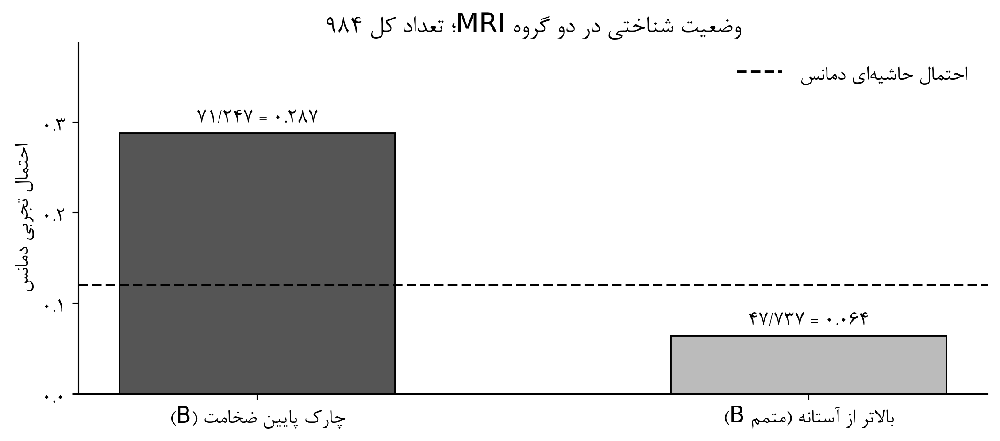
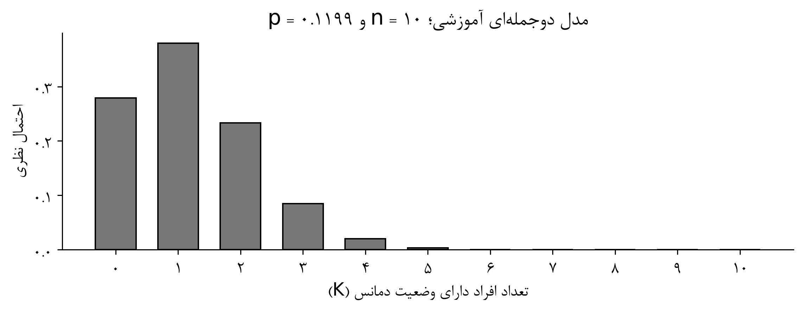
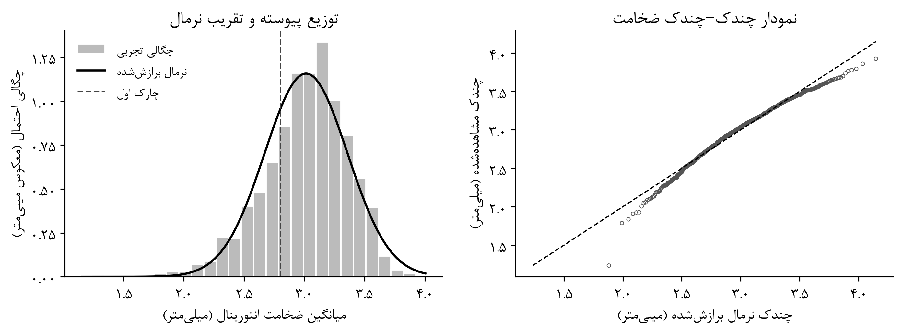
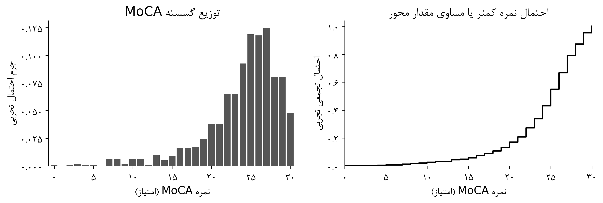
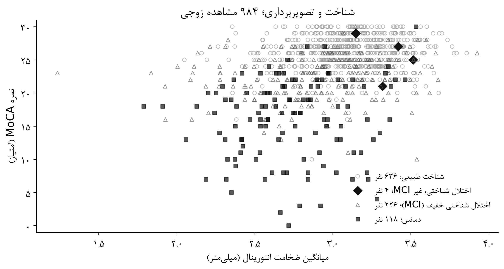

# احتمال و توزیع‌های احتمالیِ شناخت و تصویربرداری

**پروژهٔ درس آمار | پاییز ۱۴۰۵ | فاز دوم**  
مسیر ج: NACC UDS + MRI  
**نام و نام خانوادگی: آرام بقائی راد**  
**شمارهٔ دانشجویی: ۴۰۳۱۰۰۰۷۶**

## ۱. سؤال، هدف و خلاصهٔ یافته‌ها

«نمرهٔ MoCA و میانگین ضخامت قشر انتورینال در گروه‌های مختلف وضعیت شناختیِ شرکت‌کنندگان، چه توزیع و تفاوت‌های توصیفی دارند؟»

این فاز به بررسی احتمالی نمرهٔ MoCA و ضخامت قشر انتورینال اختصاص دارد. در این تحلیل، توزیع‌های مشاهده‌شده به زبان احتمال تجربی بیان می‌شوند: انتخاب یکنواخت یک فرد از نمونهٔ اصلی، احتمال وضعیت دمانس در گروه‌های ضخامت انتورینال، مدل آموزشی شمارش دوجمله‌ای، تقریب نرمال ضخامت، ممان‌ها و کوواریانس دو سنجه. این صورت‌بندی، سؤال تازه‌ای دربارهٔ پیش‌بینی بالینی یا علت بیماری ایجاد نمی‌کند.

نمونهٔ اصلی شامل ۹۸۴ فرد با یک رکورد در هر وجه و هر دو سنجهٔ معتبر است. رویداد A، وضعیت دمانسِ ثبت‌شده در UDS، و رویداد B، ضخامت دوطرفهٔ کمتر یا مساوی چارک اول همین نمونه (۲٫۸۰۲ میلی‌متر)، تعریف شد. احتمال تجربی A برابر ۰٫۱۲۰ و احتمال A با شرط B برابر ۰٫۲۸۷ است؛ در گروه بالاتر از آستانه این احتمال ۰٫۰۶۴ است. حد MRI اکتشافی و مبتنی بر توزیع نمونه است و اعتبار تشخیصی ندارد.

MoCA چوله به چپ و محدود به نمره‌های صحیح صفر تا سی است. ضخامت انتورینال نیز چولگی منفی و چند مقدار پایین دورافتاده دارد؛ نرمال برای مرکز توزیع تقریب آموزشی بهتری از دنباله‌ها فراهم می‌کند. کوواریانس نمونه‌ای دو سنجه ۰٫۵۴۹۵۸۴ امتیاز×میلی‌متر و جهت کلی مثبت است؛ ترکیب گروه‌های شناختی در این الگو سهم قابل توجهی دارد. هیچ‌یک از این احتمال‌ها شیوع جمعیتی، آزمون تشخیصی یا رابطهٔ علّی را اثبات نمی‌کند.

همهٔ نه تکلیف مشترک و پنج تکلیف مسیر ج در بخش‌های بعد و سند پوشش الزامات مشخص شده‌اند. تحلیل حاضر در محدودهٔ فاز دوم است؛ استنباط رسمی به فازهای بعد تعلق دارد.

## ۲. داده، اتصال و کنترل مراجعه‌های تکراری

دو فایل فردی هرکدام ۱۲۳۷ ردیف و ۱۲۳۷ شناسهٔ یکتا دارند؛ فایل UDS شامل ۱۸۰ ستون و MRI شامل ۱۲۶ ستون است. اتصال با `NACCID` و کنترل `one_to_one` انجام شد. منبع گروه‌بندی، `NACCUDSD` در UDS است؛ ستون هم‌نام MRI جدا نگه داشته و توافق آن بررسی شد. اثر انگشت SHA-256 هر سه CSV ثبت و نسخهٔ ورودی‌ها کنترل شده است؛ تغییر پسوند بارگذاری محتوای فایل‌ها را تغییر نمی‌دهد.

### جدول ۱. جریان رکوردها و نمونهٔ تحلیل

| مرحله | تعداد |
| --- | --- |
| رکورد خام UDS | ۱۲۳۷ |
| فرد یکتای UDS | ۱۲۳۷ |
| رکورد اضافی ناشی از شناسهٔ تکراری UDS | ۰ |
| رکورد خام MRI | ۱۲۳۷ |
| فرد یکتای MRI | ۱۲۳۷ |
| رکورد اضافی ناشی از شناسهٔ تکراری MRI | ۰ |
| پیوند مشترک | ۱۲۳۷ |
| فقط UDS | ۰ |
| فقط MRI | ۰ |
| اختلاف طبقهٔ UDS و MRI | ۰ |
| حذف مرحله‌ای: وضعیت نامعتبر | ۰ |
| حذف مرحله‌ای: MoCA نامعتبر یا حل‌نشده | ۲۵۳ |
| حذف مرحله‌ای: ضخامت ناموجود | ۰ |
| نمونهٔ اصلی | ۹۸۴ |

در این نسخه برای هر شناسه تنها یک رکورد موجود است؛ قاعدهٔ انتخاب، «استفاده از تنها رکورد آمادهٔ هر فرد» است. در فایل‌های حاضر تعداد رکورد اضافی ناشی از مراجعهٔ تکراری صفر است؛ این عدد به معنی صفر بودن مراجعات تاریخی افراد نیست. شناسه یا شمارهٔ مراجعه، تاریخ مراجعه، شناسهٔ اسکن و تاریخ MRI در ستون‌ها موجود نیستند. بنابراین انتخاب مراجعهٔ نخست، آخرین مراجعه یا نزدیک‌ترین اسکن ممکن نیست و چنین انتخابی ادعا نمی‌شود. در ورودی جدید با شناسهٔ تکراری، کد متوقف می‌شود.

ماتریس مجاورت پس از جداسازی برچسب‌ها ابعاد ۶۲×۶۲ دارد و ناحیه×ناحیه است؛ `NACCID` ندارد و دادهٔ شرکت‌کننده نیست. ماتریس دودویی و متقارن بررسی شد و وارد اتصال فردی نشد. پرسش حاضر به تحلیل شبکه نیاز ندارد. کنترل یکتایی از چندبارشماری فرد جلوگیری می‌کند؛ استقلال زیستی یا وابستگی مرکز و خانواده را بدون فراداده ثابت نمی‌کند.

## ۳. اعتبار سنجه‌ها، گمشدگی و جامعهٔ احتمال

MoCA همان `MOCATOTS` خام و بدون تصحیح تحصیلات است؛ مقدار معتبر باید عدد صحیح متناهی از صفر تا سی باشد [۳]. تعداد ۴ کد ویژه، ۵ مقدار خارج دامنه و ۲۴۴ مقدار اعشاری داخل دامنهٔ حل‌نشده وارد تحلیل اصلی نمی‌شوند. اعشار گرد نشده و کد ناموجود با صفر جایگزین نشده است. صفر واقعی MoCA نمره‌ای مجاز است. دو نیمکرهٔ MRI باید هر دو متناهی و مثبت باشند؛ شاخص Y میانگین سادهٔ آن‌هاست:

Y = (LH_ENTORHINAL_AVGTH + RH_ENTORHINAL_AVGTH) / 2

### جدول ۲. دسترسی سنجه‌ها قبل و پس از محدودسازی

| جمعیت | سنجه | کل افراد | معتبر | ناموجود تحلیلی |
| --- | --- | --- | --- | --- |
| پیوندی | MoCA | ۱۲۳۷ | ۹۸۴ | ۲۵۳ |
| پیوندی | ضخامت | ۱۲۳۷ | ۱۲۳۷ | ۰ |
| اصلی | MoCA و ضخامت | ۹۸۴ | ۹۸۴ | ۰ |

در CSVهای خام هیچ سلول تهیِ صریح برای این سنجه‌ها وجود ندارد؛ ناموجودی تحلیلی MoCA پس از قواعد اعتبار آشکار می‌شود. نام فایل `imputed` و وجود اعشار با آماده‌سازی قبلی سازگار است، اما روش، نشانگر سلول‌های جایگذاری‌شده و مقادیر پیش از جایگذاری موجود نیست. صحیح بودن نمره، مشاهدهٔ اصیل بودن آن را ثابت نمی‌کند؛ این پروژه هیچ جایگذاری تازه‌ای اجرا نمی‌کند.

همهٔ احتمال‌های اصلی، آستانهٔ MRI، نمودارهای فاز دوم و کوواریانس روی همان ۹۸۴ فرد محاسبه می‌شوند تا مخرج ثابت بماند. جدول دسترسی MRI در همهٔ افراد پیوندی فقط توصیف تکمیلی است و با احتمال‌های اصلی مخلوط نمی‌شود. در این زیرمجموعه همهٔ UDSها MRI دارند؛ اثر انتخاب افرادِ دارای MRI بر افراد فاقد MRI قابل اندازه‌گیری نیست. افزون بر انتخاب اولیه، حذف MoCA نامعتبر می‌تواند ترکیب گروه‌ها را تغییر دهد؛ فراوانی‌های دسترسی گروهی در جدول `p2_13_availability_by_group.csv` گزارش شده‌اند.

فضای نمونهٔ تجربی Ω، مجموعهٔ افراد نمونهٔ اصلی است. در آزمایش مفهومی «انتخاب یکنواخت یک فرد از Ω»، هر فرد احتمال یک بر تعداد کل دارد. احتمال یک رویداد، نسبت فراوانی آن در Ω است. این تعریف دقیقِ احتمال تجربی است، نه ادعای نمونه‌گیری احتمالی NACC از جمعیت عمومی.

## ۴. تعریف رویدادها و متغیرهای تصادفی

واحد همهٔ تعریف‌های زیر یک شرکت‌کننده در نمونهٔ اصلی است. همهٔ افراد واجد وضعیت شناختی، MoCA و دو نیمکرهٔ معتبرند؛ فرد ناموجود در تعریف رویداد، به‌جای قرارگرفتن در متمم، پیش‌تر از فضای نمونه کنار گذاشته می‌شود.

### جدول ۳. تعریف‌های عملیاتی

| نماد | تعریف و منبع | مقیاس و مخرج |
| --- | --- | --- |
| A | NACCUDSD در UDS برابر ۴؛ وضعیت دمانس، با هر علت | رویداد دودویی؛ ۹۸۴ فرد |
| B | Y کمتر یا مساوی چارک اول در نمونهٔ اصلی | رویداد MRI؛ آستانهٔ ۲٫۸۰۲ میلی‌متر |
| X | MOCA_CLEAN؛ MOCATOTS خام معتبر | گسسته، صفر تا سی امتیاز؛ ۹۸۴ فرد |
| Y | ENTORHINAL_BILATERAL_MEAN؛ میانگین دو نیمکره | پیوسته، میلی‌متر؛ ۹۸۴ فرد |
| I_A | نشانگر وضعیت دمانس؛ یک در A و صفر در متمم آن | برنولی در توزیع تجربی |
| K | تعداد وضعیت دمانس در ده فرد فرضی مستقل | شمارش نظری در مدل آموزشی بخش ۷ |

A = {i ∈ Ω : NACCUDSDUDS,i = 4} B = {i ∈ Ω : Yi ≤ Q0.25(Y)}

چارک با درون‌یابی خطی محاسبه شد. آستانه با استفاده از MRI و قاعدهٔ چارک پایین تعیین می‌شود و برای بیشینه‌کردن تفاوت دمانس جست‌وجو نشده است؛ این قاعده در تحلیل حاضر اکتشافی است و پیش‌ثبت مستقل پیش از مشاهدهٔ داده محسوب نمی‌شود. به دلیل تساوی ۲ مشاهده با مقدار آستانه، رویداد B شامل ۲۴۷ نفر، معادل ۲۵٫۱۰ درصد است و الزاماً دقیقاً یک‌چهارم نمونه نیست. برچسب «چارک پایین» معنای توزیعی دارد؛ سنجه به تشخیص یا شدت بیماری تبدیل نشده است.

متمم A شامل سه گروه طبیعی، اختلال غیر MCI و MCI است؛ این ادغام فقط برای مثال دودویی دمانس در برابر سایر وضعیت‌هاست و نام «سالم» به متمم داده نمی‌شود. گروه‌بندی چهارگانه در جدول بعد و نمودار پراکنش حفظ می‌شود. A از تشخیص ثبت‌شدهٔ UDS و B از MRI ساخته شده است؛ تعریف یکی، خودِ تعریف دیگری نیست. MoCA برای تعریف A به آستانهٔ تازه‌ای تبدیل نشده است. دمانس نیز معادل تشخیص علت‌شناختی آلزایمر نیست [۵].

## ۵. احتمال‌های حاشیه‌ای و مشترک دو وجه

### جدول ۴. جدول توافقی UDS و MRI؛ فراوانی افراد

| وضعیت UDS | B: ضخامت در چارک پایین | متمم B: بالاتر از آستانه | جمع |
| --- | --- | --- | --- |
| دمانس (A) | ۷۱ | ۴۷ | ۱۱۸ |
| سایر وضعیت‌ها (متمم A) | ۱۷۶ | ۶۹۰ | ۸۶۶ |
| جمع | ۲۴۷ | ۷۳۷ | ۹۸۴ |

انتخاب یکنواخت یک فرد از نمونهٔ اصلی مبنای هر سه احتمال زیر است؛ بنابراین مخرج همهٔ آن‌ها کل نمونه است.

P̂(A) = n(A)/N = 118/984 = 0.119919 P̂(B) = n(B)/N = 247/984 = 0.251016 P̂(A ∩ B) = n(A ∩ B)/N = 71/984 = 0.072154

به‌ترتیب ۱۱٫۹۹ درصد افراد نمونه دمانس دارند، ۲۵٫۱۰ درصد در چارک پایین ضخامت‌اند و ۷٫۲۲ درصد هر دو ویژگی را دارند. «هر دو ویژگی» با «احتمال دمانس در میان کم‌ضخامت‌ها» فرق دارد، زیرا مخرج حالت دوم فقط افراد گروه B است.

### جدول ۵. احتمال مشترک هر خانه؛ مخرج ثابت ۹۸۴

|  | B | متمم B | حاشیهٔ UDS |
| --- | --- | --- | --- |
| A | ۰٫۰۷۲۱۵۴ | ۰٫۰۴۷۷۶۴ | ۰٫۱۱۹۹۱۹ |
| متمم A | ۰٫۱۷۸۸۶۲ | ۰٫۷۰۱۲۲۰ | ۰٫۸۸۰۰۸۱ |
| حاشیهٔ MRI | ۰٫۲۵۱۰۱۶ | ۰٫۷۴۸۹۸۴ | ۱٫۰۰۰۰۰۰ |

چهار خانهٔ داخلی جمعاً احتمال یک می‌دهند؛ حاشیه‌های سطری و ستونی نیز با فراوانی‌های جدول ۴ تطبیق دارند. احتمال مشترک از هر دو حاشیه بزرگ‌تر نیست. کنترل‌ها روی اعداد کامل و پیش از گردکردن نمایش انجام شده‌اند.

### جدول ۶. حفظ طبقه‌بندی چهارگانه در دو گروه MRI

| گروه | کل گروه | در B | در متمم B | احتمال گروه با شرط B | با شرط متمم B |
| --- | --- | --- | --- | --- | --- |
| شناخت طبیعی | ۶۳۶ | ۹۵ | ۵۴۱ | ۰٫۳۸۴۶ | ۰٫۷۳۴۱ |
| اختلال شناختی، غیر MCI | ۴ | ۰ | ۴ | ۰٫۰۰۰۰ | ۰٫۰۰۵۴ |
| اختلال شناختی خفیف (MCI) | ۲۲۶ | ۸۱ | ۱۴۵ | ۰٫۳۲۷۹ | ۰٫۱۹۶۷ |
| دمانس | ۱۱۸ | ۷۱ | ۴۷ | ۰٫۲۸۷۴ | ۰٫۰۶۳۸ |

مخرج دو ستون احتمال به‌ترتیب ۲۴۷ و ۷۳۷ است؛ هر ستون در چهار گروه جمعاً یک می‌شود. گروه غیر MCI با ۴ نفر برای تعمیم الگویی پایدار کافی نیست.

## ۶. احتمال شرطی و بررسی استقلال

در شرط‌کردن، فضای مقایسه از کل Ω به افراد دارای ویژگی شرط محدود می‌شود. برای احتمال دمانس با شرط MRI، صورت تعداد دمانس همان گروه و مخرج کل افراد همان گروه است:

P̂(A | B) = P̂(A ∩ B)/P̂(B) = 71/247 = 0.287449 P̂(A | Bᶜ) = 47/737 = 0.063772 P̂(B | A) = 71/118 = 0.601695

در افراد چارک پایین ضخامت، احتمال تجربی دمانس ۲۸٫۷۴ درصد و در افراد بالاتر از آستانه ۶٫۳۸ درصد است؛ اختلاف توصیفی ۲۲٫۳۷ واحد درصد است. جهت شرط قابل جابه‌جایی نیست: احتمال B در میان دمانس‌ها، ۶۰٫۱۷ درصد، به پرسش دیگری پاسخ می‌دهد. اگر مخرج شرط صفر باشد، کد مقدار تعریف‌نشده ثبت می‌کند؛ در این داده هر دو شرط مخرج مثبت دارند.

*شکل ۱. احتمال تجربی دمانس در دو گروه MRI. خط‌چین احتمال حاشیه‌ای دمانس در کل نمونه است؛ بالای ستون‌ها صورت و مخرج آمده است.*

برای استقلال، احتمال مشترک باید با حاصل‌ضرب حاشیه‌ها برابر باشد:

P̂(A)P̂(B) = 0.119919 × 0.251016 = 0.030102 P̂(A ∩ B) − P̂(A)P̂(B) = 0.042053

احتمال مشترک مشاهده‌شده ۰٫۰۷۲۱۵۴ است و از حاصل‌ضرب حاشیه‌ها بیشتر است. همچنین احتمال A با شرط B با احتمال حاشیه‌ای A برابر نیست. بنابراین در توزیع تجربی این نمونه، دو رویداد مستقل نیستند و همراهی توصیفی دارند. این مقایسه آزمون استقلال جمعیتی نیست و دربارهٔ معناداری آماری یا نبود تصادف نمونه‌گیری حکمی صادر نمی‌کند؛ حتی برابری تقریبی دو برآورد نیز استقلال جمعیتی را اثبات نمی‌کرد.

## ۷. متغیر گسسته و مدل دوجمله‌ای

نشانگر I_A در انتخاب یک فرد، مقدار یک با احتمال تجربی ۰٫۱۱۹۹۱۹ و مقدار صفر با احتمال متمم دارد. برای تمرین مدل‌سازی، K شمار افراد دارای وضعیت دمانس در ۱۰ فرد فرضی مستقل با احتمال ثابت p تعریف می‌شود. در محاسبهٔ آموزشی p را برابر فراوانی مشاهده‌شدهٔ A قرار می‌دهیم؛ این کار p را به احتمال معلوم جمعیتی تبدیل نمی‌کند [۲،۶].

K ∼ Binomial(n=10, p=118/984) P(K=k) = C(n,k) pk(1−p)n−k, &nbsp; k=0,…,n

فرض‌های لازم عبارت‌اند از تعداد ثابت ده فرد، پیامد دودویی دمانس/سایر، استقلال افراد و احتمال یکسان در همهٔ آزمون‌ها. یکتایی NACCID از تکرار رکورد فرد جلوگیری می‌کند، ولی استقلال مرکز و خانواده را تضمین نمی‌کند. ثابت بودن احتمال نیز با تفاوت گروه‌های MRI سازگار نیست، مگر آزمایش فرضی از ترکیب ثابت و مشترکی فرد انتخاب کند. NACC نمونهٔ احتمالی جمعیت نیست؛ بنابراین این مدل تقریب آموزشی از شمارش فرضی است.

در برداشت بدون جایگذاری از همین مجموعهٔ محدود، آزمون‌ها دقیقاً مستقل نیستند و مدل دقیق دوجمله‌ای نیست؛ نسبت اندازهٔ ده‌نفری به کل نمونه فقط ۱٫۰۲ درصد است، بنابراین وابستگی ناشی از برداشت محدود کوچک‌تر می‌شود، اما دیگر محدودیت‌ها را برطرف نمی‌کند. مراجعه‌های یک فرد هرگز ده آزمون مستقل تلقی نمی‌شوند.

### جدول ۷. احتمال‌های محاسبه‌شده از مدل

| کمیت | فرمول | مقدار |
| --- | --- | --- |
| دقیقاً دو نفر | C(10,2)p²(1−p)⁸ | ۰٫۲۳۲۹۰۰ |
| حداقل یک نفر | 1−(1−p)¹⁰ | ۰٫۷۲۱۲۴۲ |
| حداکثر دو نفر | جمع P(K=k) برای k=0,1,2 | ۰٫۸۹۱۴۹۰ |
| امید شمارش | 10p | ۱٫۱۹۹۱۸۷ |
| واریانس شمارش | 10p(1−p) | ۱٫۰۵۵۳۸۲ |

P(K=2) = 45 × (118/984)² × (1−118/984)⁸ = 0.232900

*شکل ۲. تابع جرم نظری K؛ همهٔ شمارش‌های صفر تا ده نمایش داده شده‌اند. مجموع احتمال‌ها و ممان‌های آن هم با SciPy و هم فرمول ترکیبی بررسی شده است. این نمودار توزیع فراوانی ده‌تایی‌های مشاهده‌شده نیست.*

## ۸. توزیع پیوسته و تقریب نرمال ضخامت

### جدول ۸. خلاصهٔ توزیع ضخامت؛ واحد اندازه میلی‌متر

| جمعیت | n | میانگین | واریانس تجربی (mm²) | واریانس نمونه‌ای (mm²) | چولگی |
| --- | --- | --- | --- | --- | --- |
| نمونهٔ اصلی | ۹۸۴ | ۳٫۰۱۴۲۸۸ | ۰٫۱۱۸۸۹۴ | ۰٫۱۱۹۰۱۵ | -۰٫۶۱۳ |
| همهٔ پیوندی‌ها | ۱۲۳۷ | ۳٫۰۱۳۷۶۳ | ۰٫۱۲۶۷۰۲ | ۰٫۱۲۶۸۰۵ | -۰٫۸۱۸ |

در نمونهٔ اصلی، میانه ۳٫۰۴۹۸، چارک اول ۲٫۸۰۲۰، چارک سوم ۳٫۲۵۵۱ و دامنه ۱٫۲۳۵۵ تا ۳٫۹۲۵۰ میلی‌متر است. چولگی -۰٫۶۱۳، دنبالهٔ پایین و اختلاف میانگین و میانه، تقارن کامل را تأیید نمی‌کنند. با حصار ۱٫۵×IQR، تعداد ۱۳ مقدار زیر ۲٫۱۲۲۳ و ۰ مقدار بالای ۳٫۹۳۴۸ میلی‌متر پرچم بازبینی دارند. این موارد حذف نشده‌اند؛ بدون تصویر و کنترل کیفیت، پرچم آماری برابر خطا نیست.

*شکل ۳. چپ: هیستوگرام با مساحت یک و چگالی نرمال برازش‌شده. راست: چندک مشاهده‌شده در برابر چندک نرمال، با احتمال‌های (i − 0.5)/N؛ خط‌چین خط برابری است، نه خط رگرسیون.*

پارامترهای منحنی از همین داده محاسبه شدند: μ برابر ۳٫۰۱۴۲۸۸ و σ برابر ۰٫۳۴۴۸۱۰ میلی‌متر؛ σ ریشهٔ واریانس تجربی با مخرج N است. بخش مرکزی در نمودار چندک–چندک به خط نزدیک‌تر است، اما انتهای پایین انحراف آشکار دارد. بنابراین نرمال توصیفی تقریبی برای مرکز است و برای احتمال دنباله‌های پایین یا آستانه‌های تشخیصی توجیه کافی ندارد. آزمون نرمالی جایگزین مشاهدهٔ شکل نشده است.

برای یک مقایسهٔ احتمالی، بازهٔ μ ± σ برابر ۲٫۶۶۹۵ تا ۳٫۳۵۹۱ میلی‌متر است؛ ۶۸۰ نفر از ۹۸۴ نفر در آن‌اند، یعنی احتمال تجربی ۰٫۶۹۱۰۵۷. احتمال همین بازه در نرمال برازش‌شده ۰٫۶۸۲۶۸۹ است. در آستانهٔ B، احتمال نرمال ۰٫۲۶۹۰۵۸ در برابر احتمال تجربی ۰٫۲۵۱۰۱۶ قرار دارد. بازهٔ μ ± σ فاصلهٔ اطمینان میانگین نیست. Y پیوسته مدل می‌شود، هرچند اندازه‌ها با دقت محدود ثبت شده‌اند؛ چگالی در یک نقطه نیز خودِ احتمال آن نقطه نیست.

## ۹. توزیع شناختی و مقایسهٔ چهار گروه

MoCA در نمونهٔ اصلی ۹۸۴ مقدار معتبر و بدون ناموجودی باقیمانده دارد. میانگین ۲۴٫۰۲۸۴۵۵، میانه ۲۵٫۰۰۰، واریانس تجربی ۲۲٫۴۳۸۲۱۵ و واریانس نمونه‌ای ۲۲٫۴۶۱۰۴۱ امتیاز مربع است. چولگی -۱٫۶۴۴ و تمرکز نمره‌های بالا همراه دنبالهٔ پایین دیده می‌شود. حصار پایین ۱۴٫۵۰ است و ۴۸ نمره زیر آن قرار دارند؛ ۰ نمره بالای حصار بالایی وجود دارد. حداقل و حداکثر ۰ و ۳۰ هستند. مقادیر درون دامنه، از جمله صفر، به دلیل دورافتادگی حذف نشدند.

*شکل ۴. تابع جرم احتمال و تابع توزیع تجمعی تجربی MoCA در نمونهٔ اصلی؛ فراوانی‌های صفر نیز در نقاط صفر تا سی حفظ شده‌اند. جهش تابع تجمعی متناسب با جرم هر نمره است.*

MoCA متغیری صحیح و محدود است؛ منحنی چگالی پیوسته برای آن تابع جرم احتمال نیست. به‌ویژه به دلیل کران بالا و چولگی، تقریب نرمال خامِ نمره برای احتمال دنباله‌ها مناسب نیست. در این بخش توزیع تجربی گسسته مبنای محاسبه است.

### جدول ۹. میانگین، واریانس تجربی و چولگی در گروه‌ها

| گروه | سنجه | n | میانگین | واریانس تجربی | چولگی |
| --- | --- | --- | --- | --- | --- |
| شناخت طبیعی | MoCA | ۶۳۶ | ۲۶٫۱۳۰۵ | ۶٫۴۵۶۲۴ | -۰٫۹۷۴ |
| شناخت طبیعی | ضخامت | ۶۳۶ | ۳٫۰۹۹۴ | ۰٫۰۸۱۷۸ | -۰٫۳۷۷ |
| اختلال شناختی، غیر MCI | MoCA | ۴ | ۲۵٫۵۰۰۰ | ۸٫۷۵۰۰۰ | -۰٫۷۵۳ |
| اختلال شناختی، غیر MCI | ضخامت | ۴ | ۳٫۳۴۹۹ | ۰٫۰۱۸۵۰ | -۰٫۶۰۰ |
| اختلال شناختی خفیف (MCI) | MoCA | ۲۲۶ | ۲۲٫۳۰۰۹ | ۱۱٫۳۸۷۳۴ | -۰٫۶۲۱ |
| اختلال شناختی خفیف (MCI) | ضخامت | ۲۲۶ | ۲٫۹۱۵۸ | ۰٫۱۵۲۳۹ | -۰٫۶۳۳ |
| دمانس | MoCA | ۱۱۸ | ۱۵٫۹۵۷۶ | ۳۵٫۴۶۴۳۱ | -۰٫۴۱۵ |
| دمانس | ضخامت | ۱۱۸ | ۲٫۷۳۲۸ | ۰٫۱۱۷۴۴ | ۰٫۰۴۰ |

واریانس MoCA با واحد امتیاز مربع و واریانس ضخامت با واحد میلی‌متر مربع است؛ مقایسهٔ بزرگی عددی این دو واریانس معنای مقایسهٔ زیستی پراکندگی ندارد. گروه غیر MCI تنها ۴ نفر دارد و شکل توزیع آن پایدار قابل ارزیابی نیست. مخلوط‌بودن گروه‌ها یکی از دلایل تفاوت شکل کلی با شکل درون هر گروه است. خلاصه‌های چارکی، دامنه و پرچم‌های گروهی در `p2_08_distributions_by_group.csv` آمده‌اند. در این بخش، توزیع هر دو سنجه با تابع احتمال و ممان‌های تجربی بررسی می‌شود.

## ۱۰. امید ریاضی و دو قرارداد واریانس

در توزیع تجربی، به هر فرد وزن یک بر N داده می‌شود. اگر p̂(x) فراوانی نسبی هر نمره باشد، امید تجربی X دقیقاً با میانگین حسابی نمونه برابر است؛ این تساوی با برابری میانگین نمونه و میانگین ناشناختهٔ جمعیت فرق دارد [۲].

Eemp(X) = Σx x p̂(x) = (1/N)Σixi = x̄ Varemp(X) = Σx(x−x̄)²p̂(x) = SSX/N s²X = SSX/(N−1) = [N/(N−1)] Varemp(X)

برای MoCA، جمع نمره‌ها ۲۳۶۴۴ و مجموع مجذور انحراف‌ها ۲۲۰۷۹٫۲۰۳۲۵۲ است؛ برای Y، جمع اندازه‌ها ۲۹۶۶٫۰۵۹۰ و مجموع مجذور انحراف‌ها ۱۱۶٫۹۹۱۴۸۰ است. محاسبهٔ عددی:

Eemp(X) = 23644/984 = 24.028455 Varemp(X) = 22079.203252/984 = 22.438215 s²X = 22079.203252/983 = 22.461041 Eemp(Y) = 2966.0590/984 = 3.014288 Varemp(Y) = 116.991480/984 = 0.118894 s²Y = 116.991480/983 = 0.119015

واریانس تجربی، پراکندگی دقیق توزیع محدودِ افراد حاضر است. واریانس نمونه‌ای با تصحیح درجات آزادی، تحت نمونه‌گیری مستقل و هم‌توزیع و وجود واریانس، برآوردگر نااریب واریانس جمعیت است؛ تنها استفاده از مخرج N−۱، نمونهٔ غیرتصادفی NACC را نمایندهٔ جمعیت نمی‌کند. هر دو قرارداد آشکار گزارش شده‌اند و با یک نام مخلوط نشده‌اند.

### جدول ۱۰. مقایسهٔ ممان‌های تجربی و نظری

| متغیر | امید | واریانس | ماهیت |
| --- | --- | --- | --- |
| X: MoCA | ۲۴٫۰۲۸۴۵۵ | ۲۲٫۴۳۸۲۱۵ | تجربی؛ امتیاز و امتیاز مربع |
| Y: ضخامت | ۳٫۰۱۴۲۸۸ | ۰٫۱۱۸۸۹۴ | تجربی؛ میلی‌متر و میلی‌متر مربع |
| I_A | ۰٫۱۱۹۹۱۹ | ۰٫۱۰۵۵۳۸ | برنولی در توزیع تجربی |
| K: شمار ده‌نفری | ۱٫۱۹۹۱۸۷ | ۱٫۰۵۵۳۸۲ | نظری؛ تحت فرض‌های دوجمله‌ای |

امید K برابر ۱٫۱۹۹ نفر، میانگین شمار در تکرار آزمایش فرضی است؛ لازم نیست عدد صحیح یا شمارِ یک گروه واقعی باشد. امید X برابر ۲۴٫۰۲۸ امتیاز، میانگین نمرهٔ فردِ انتخاب‌شده از همین نمونه است؛ امید Y نیز میانگین اندازهٔ MRI همین انتخاب است. ممان‌ها خلاصهٔ الگو هستند و وضعیت شناختی یک فرد معین را تعیین نمی‌کنند.

## ۱۱. کوواریانس شناخت و تصویربرداری

هر دو متغیر برای ۹۸۴ فرد به‌طور زوجی موجودند. تعداد زوج‌ها و مخرج کوواریانس از همان سطرهای مشترک محاسبه شده‌اند؛ نمرهٔ یک فرد با MRI فرد دیگر جفت نشده است. دو تعریف:

Covemp(X,Y) = [Σ(xi−x̄)(yi−ȳ)]/N sXY = [Σ(xi−x̄)(yi−ȳ)]/(N−1) SP = 540.241447; &nbsp; Covemp = 0.549026; &nbsp; sXY = 0.549584

*شکل ۵. یک نقطه برای هر فرد؛ محور افقی ضخامت به میلی‌متر و محور عمودی MoCA به امتیاز است. به دلیل گسسته بودن MoCA، ردیف‌های افقی و هم‌پوشانی نقطه‌ها طبیعی است؛ برای تغییر ندادن داده‌ها جابه‌جایی تصادفی اضافه نشده است.*

### جدول ۱۱. کوواریانس کلی و گروه‌های دارای حداقل بیست نفر

| گروه | زوج کامل | کوواریانس تجربی | کوواریانس نمونه‌ای |
| --- | --- | --- | --- |
| همهٔ افراد | ۹۸۴ | ۰٫۵۴۹۰۲۶ | ۰٫۵۴۹۵۸۴ |
| شناخت طبیعی | ۶۳۶ | ۰٫۰۷۰۱۴۲ | ۰٫۰۷۰۲۵۳ |
| اختلال شناختی خفیف (MCI) | ۲۲۶ | ۰٫۲۲۳۶۳۶ | ۰٫۲۲۴۶۳۰ |
| دمانس | ۱۱۸ | ۰٫۱۹۷۲۸۶ | ۰٫۱۹۸۹۷۲ |

علامت مثبت نشان می‌دهد در مجموعهٔ حاضر مقادیر بالاتر ضخامت عموماً با نمرهٔ بالاتر همراه‌اند؛ پراکندگی و هم‌پوشانی زیاد است. واحد کوواریانس امتیاز×میلی‌متر است؛ با تغییر واحد MRI به سانتی‌متر، اندازهٔ عددی آن یک‌دهم می‌شود. کوواریانس ضریب استانداردشده، شیب رگرسیون یا معیار دقت پیش‌بینی نیست. گروه غیر MCI با ۴ نفر برای تفسیر مستقل کوواریانس کنار گذاشته شده، ولی در محاسبهٔ کلی حضور دارد.

### ۱۱–۱. نقش ترکیب گروه‌ها، گمشدگی و مقادیر دورافتاده

میانگین‌های MoCA و ضخامت بین گروه‌های شناختی فرق دارند؛ بنابراین کوواریانس کلی، همراهی درون گروه و جابه‌جایی میانگین گروه‌ها را با هم ترکیب می‌کند. با همان توزیع تجربی و بدون برازش مدل، هویت تجزیهٔ کوواریانس به صورت زیر بررسی شد؛ G گروه چهارگانه است:

Covemp(X,Y) = ΣgwgCovemp,g(X,Y) + Σgwg(x̄g−x̄)(ȳg−ȳ) 0.549026 = 0.119805 + 0.429221, &nbsp; wg=ng/N

جزء درون‌گروهیِ وزنی ۰٫۱۱۹۸۰۵ و جزء مربوط به تفاوت میانگین گروه‌ها ۰٫۴۲۹۲۲۱ امتیاز×میلی‌متر است. بزرگی جزء دوم نشان می‌دهد خواندن کوواریانس کلی به‌عنوان همراهی یکنواخت در همهٔ گروه‌ها مناسب نیست. این تجزیه توصیفی است؛ کنترل مخدوش‌گر، اثر تعدیل‌شده یا تفسیر علّی فراهم نمی‌کند. گروه کوچک در هویت ریاضی حضور دارد، اما برای نتیجه‌گیری جداگانه استفاده نشده است.

در نمودار پراکنش، چند MRI کم‌ضخامت و نمره‌های پایین می‌توانند در حاصل‌ضرب انحراف‌ها سهم بزرگی داشته باشند. تعداد پرچم‌های IQR در بخش‌های ۸ و ۹ گزارش شده است و هیچ فردی بر پایهٔ این پرچم‌ها حذف نشده است. اثر حذف دورافتاده‌ها در این فاز برآورد نمی‌شود. همچنین حذف MoCA نامعتبر می‌تواند میانگین‌ها و کوواریانسِ نمونهٔ کامل را نسبت به کل افراد تغییر دهد؛ کوواریانس حاضر فقط افراد واجد هر دو سنجه را توصیف می‌کند.

نبود تاریخ اسکن و مراجعه امکان ارزیابی فاصلهٔ زمانی شناخت و تصویربرداری را سلب می‌کند. مشاهدهٔ همراهی، جهت زمانی یا این ادعا را ثابت نمی‌کند که تغییر ضخامت باعث تغییر شناخت شده است. نقش سن، تحصیلات، مرکز، تشخیص و عوامل دیگر در این فاز با مدل تعدیل نشده است. محاسبهٔ استنباطی همبستگی یا رگرسیون در این تحلیل انجام نشده است.

## ۱۲. قضیهٔ بیز و به‌روزرسانی احتمال تجربی

ساختار A و B برای مثال بیز مناسب است: ابتدا فرد به‌طور یکنواخت از نمونهٔ اصلی انتخاب می‌شود؛ سپس فقط معلوم می‌شود ضخامت او در گروه B است. «پیشین» در این مثال احتمال حاشیه‌ای همین فضای نمونه و «پسین» احتمال شرطی بعد از دانستن B است؛ مدل بیزی برای پارامتر ناشناخته و توزیع پیشین پارامتر ساخته نشده است.

### جدول ۱۲. اجزای محاسبهٔ بیز

| جزء | فراوانی و مخرج | مقدار |
| --- | --- | --- |
| پیشین: P̂(A) | ۱۱۸/۹۸۴ | ۰٫۱۱۹۹۱۹ |
| احتمال شواهد در A: P̂(B∣A) | ۷۱/۱۱۸ | ۰٫۶۰۱۶۹۵ |
| احتمال شواهد در متمم A | ۱۷۶/۸۶۶ | ۰٫۲۰۳۲۳۳ |
| حاشیهٔ شواهد: P̂(B) | ۲۴۷/۹۸۴ | ۰٫۲۵۱۰۱۶ |
| پسین: P̂(A∣B) | ۷۱/۲۴۷ | ۰٫۲۸۷۴۴۹ |

P̂(A|B) = P̂(B|A)P̂(A) / P̂(B) = [(71/118)(118/984)] / (247/984) = 71/247 = 0.287449

حاشیهٔ B را می‌توان مستقل از جمع احتمال کل نیز محاسبه کرد:

P̂(B) = P̂(B|A)P̂(A) + P̂(B|Aᶜ)P̂(Aᶜ) = (71/118)(118/984) + (176/866)(866/984) = 247/984 = 0.251016

نتیجه دقیقاً با خانهٔ دمانس در ستون B جدول توافقی سازگار است: ۷۱ نفر از ۲۴۷ فرد. دانستن B، احتمال تجربی دمانس را از ۱۱٫۹۹ درصد به ۲۸٫۷۴ درصد تغییر می‌دهد. این به‌روزرسانی به ترکیب همین نمونه و آستانهٔ اکتشافی وابسته است و احتمال تشخیص یک مراجعه‌کنندهٔ جدید در جمعیت دیگری نیست.

آستانه نه با دادهٔ اعتبارسنجی مستقل ارزیابی شده و نه یک آزمون بالینی تأییدشده است. در این بخش واژهٔ «شواهد» فقط دانستن عضویت در B را بیان می‌کند؛ دقت تشخیصی، حساسیت کاربردی یا توصیهٔ پزشکی از آن نتیجه نمی‌شود. چون مثال مستقیم و قابل کنترل بیز وجود دارد، تکلیف جایگزین یا تأیید فرضی تیم درس به کار نرفته است.

## ۱۳. محدودیت‌ها و نتیجهٔ فاز دوم

احتمال‌ها و ممان‌های گزارش‌شده توزیع تجربی افراد همین زیرمجموعه‌اند. انتخاب غیرتصادفی و الزام وجود MRI، تعمیم به جمعیت را محدود می‌کند؛ گروه فاقد MRI در فایل موجود نیست. نمونهٔ اصلی افزون بر این، به اعتبار MoCA محدود است و گمشدگی تحلیلی می‌تواند انتخابی باشد. روش جایگذاری پیشین و تمایز مشاهدهٔ واقعی از مقدار بازسازی‌شده معلوم نیست و از تعداد ارقام یا صحیح بودن نمره قابل استنتاج قطعی نیست.

یکتایی شناسه در نسخهٔ موجود کنترل شده و چندبارشماری فرد رخ نداده است. بااین‌حال شمار مراجعات تاریخی، قاعدهٔ انتخاب در آماده‌سازی تیم درس، هم‌زمانی MRI و UDS و وابستگی مرکز یا خانواده حل‌نشده‌اند. گروه غیر MCI کوچک است و تعریف‌های فرهنگ عمومی، جای راهنمای اختصاصی زیرمجموعه را به‌طور قطعی نمی‌گیرند. این مجهولات محدودیت داده‌اند و با محاسبهٔ آماری قابل ساختن نیستند.

پاسخ احتمالیِ تکمیلی به سؤال اصلی این است که در نمونهٔ ثابت، عضویت در چارک پایین ضخامت با سهم بالاتر وضعیت دمانس همراه است؛ احتمال مشترک ۰٫۰۷۲۱۵۴ با استقلال تجربی سازگار نیست. توزیع MoCA گسسته و چوله است و ضخامت نیز در دنبالهٔ پایین از نرمال فاصله دارد. کوواریانس مثبتِ کلی با سهم مهم ترکیب گروه‌های شناختی همراه است. این توصیف‌ها به نمونهٔ تحلیل تعلق دارند؛ تفاوت جمعیتی، جهت علّی یا کاربرد تشخیصی را اثبات نمی‌کنند.

مدل دوجمله‌ای شمار فرضی و منحنی نرمال ابزارهای آموزشی‌اند که فرض‌هایشان بیان شده است. هیچ آزمون فرض، فاصلهٔ اطمینان، bootstrap، رگرسیون یا استنباط رسمی همبستگی برای این فاز اجرا نشده است. تصمیم‌های آستانه و حفظ دورافتاده‌ها شفاف‌اند و دادهٔ جدیدی به Dataset C اضافه نشده است.

## ۱۴. بازتولید، پوشش تکلیف‌ها و تحویل

کد اصلی `src/phase2_analysis.py`، نوتبوک اجراشدهٔ `notebooks/phase2.ipynb` و جدول‌های `p2_` مبنای گزارش‌اند. تعاریف سنجه‌ها، قواعد اعتبار و انتخاب نمونه در کد مشخص‌اند. کد و فایل‌های لازم برای اجرای تحلیل در همین بسته قرار دارند. احتمال‌ها با بازشماری مستقل و هویت‌های شرطی و بیز، و ممان‌ها با محاسبهٔ مستقل بررسی شده‌اند. جدول پوشش در `docs/PHASE2_REQUIREMENT_COVERAGE.html`، نه تکلیف مشترک و پنج تکلیف مسیر ج را به بخش، کد و خروجی مشخص متصل می‌کند.

طبق بخش ۶ راهنمای استاد، خروجی اصلی `reports/phase2.pdf` و برچسب تحویل `phase-2` است [۱]. ثبت و بارگذاری در مخزن واقعی GitHub و سامانهٔ CW اقدام بیرونی است؛ وضعیت آن جداگانه در `docs/PHASE2_SUBMISSION.md` ثبت می‌شود. ایجاد راهنمای برچسب، معادل انتشار برچسب در مخزن کاربر نیست. فایل‌های خام مطابق دستورالعمل استاد در ZIP قرار ندارند؛ بازتولید با قرار دادن همان ورودی‌ها در مسیر داده انجام می‌شود.

## منابع و یادداشت‌های روش‌شناختی

**[۱]** دستورالعمل رسمی پروژهٔ آمار، پاییز ۱۴۰۵؛ بخش ۶، صفحات ۸ تا ۱۰؛ ساختار تحویل و برچسب، صفحات ۱۸ و ۱۹. فایل ارائه‌شدهٔ تیم درس.

**[۲]** Wonnacott, T. H. & Wonnacott, R. J.، Introductory Statistics، ویرایش پنجم، Wiley؛ مرجع نظری معرفی‌شده در دستورالعمل استاد.

**[۳]** NACC، فرهنگ دادهٔ پژوهشگر UDS، نسخهٔ ۳؛ تعریف MOCATOTS و NACCUDSD.  
<https://files.alz.washington.edu/documentation/uds3-rdd.pdf>

**[۴]** NACC، فرهنگ SCAN & CLARiTI MRI؛ نام سنجه‌های AVGTH و واحد میلی‌متر. انطباق فرایند آماده‌سازی این زیرمجموعه با این فرهنگ قطعی نیست.  
<https://files.alz.washington.edu/documentation/SCAN-MRI-Imaging-RDD.pdf>

**[۵]** NACC، راهنمای پژوهشگر؛ ساختار مراجعه، داده‌های ناموجود و تمایز وضعیت دمانس از علت‌شناسی آلزایمر.  
<https://www.naccdata.org/the-nacc-researchers-guide/>

**[۶]** SciPy، مستندات تابع‌های binom و norm؛ احتمال جرمی، احتمال تجمعی و چگالی نرمال.  
<https://docs.scipy.org/doc/scipy/reference/stats.html>

نام متغیرها و قواعد اعتبار با منابع عمومی تطبیق دارند؛ راهنمای آماده‌سازی اختصاصی همراه فایل‌ها موجود نیست. روابط احتمال شرطی، بیز و ممان‌ها بر پایهٔ تعریف توزیع تجربی و مدل‌های معرفی‌شده نوشته شده‌اند، نه از برش بالینی تازه.

جزئیات فنی: چارک خطی؛ واریانس تجربی با مخرج N؛ واریانس و کوواریانس نمونه‌ای با مخرج N−۱؛ آستانهٔ MRI در نمونهٔ اصلی مشترک؛ چندک‌های نرمال با احتمال (i − 0.5)/N؛ منحنی نرمال با μ میانگین و σ ریشهٔ واریانس تجربی. محاسبات تصادفی یا شبیه‌سازی انجام نشده‌اند، بنابراین بذر تصادفی بر نتایج نقشی ندارد.
